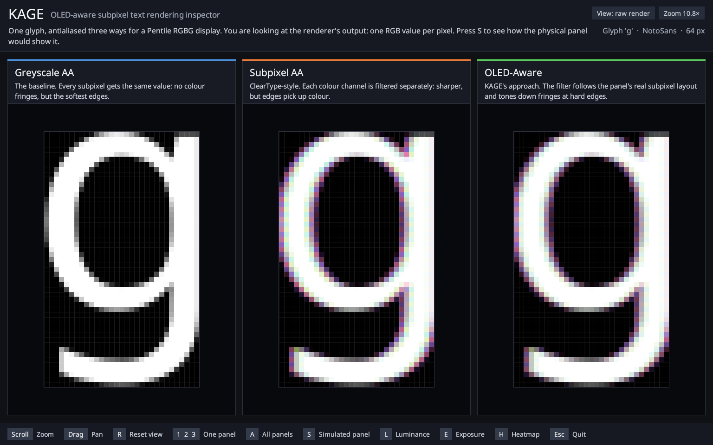
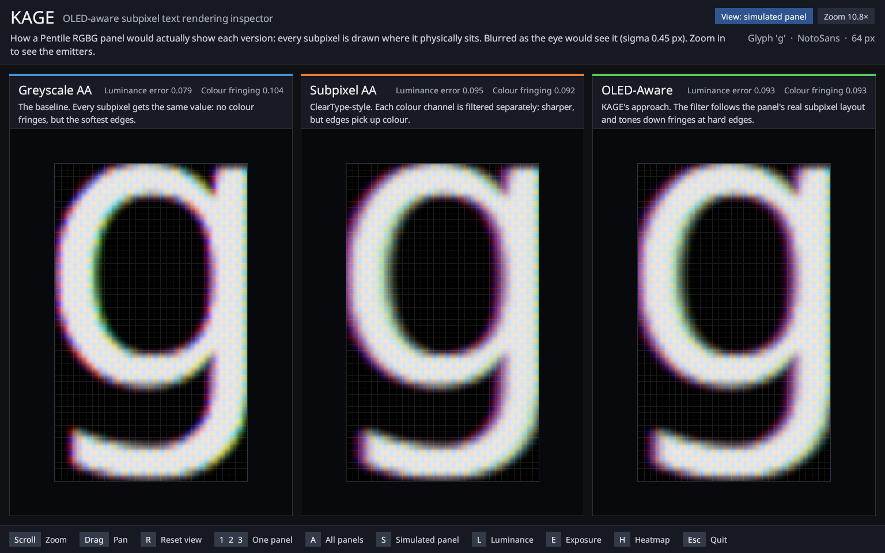

# KAGE — Kinetic Adaptive Glyph Engine
### OLED-Aware Text Rendering Research Sandbox

> A programmable experimental text rendering engine and display simulator for improving text clarity on modern OLED displays with non-standard subpixel layouts (WOLED, Pentile, Triangular).



*The inspector: one glyph antialiased three ways for a Pentile RGBG panel. Press `S` to see the same glyph as the physical panel would emit it:*



---

## Why This Project Exists

Traditional subpixel rendering — most notably Microsoft's **ClearType** — was engineered around **RGB stripe LCD** displays. Each pixel in that layout contains three predictably ordered subpixels: Red, Green, Blue, from left to right.

Modern OLED displays break that assumption entirely. Common OLED subpixel layouts include:

| Layout | Description |
|--------|-------------|
| **WRGB (WOLED)** | Adds a White subpixel alongside R, G, B |
| **Pentile RGBG** | Alternating RG / BG pairs; fewer subpixels per pixel |
| **Delta-RGB** | Triangular arrangement (QD-OLED, Alienware); vertical offsets between R/B and G |
| **Asymmetric** | Vendor-specific irregular arrangements |

Running standard LCD subpixel rendering on these displays causes:
- **Color fringing** — colored halos around letterforms
- **Reduced sharpness** — blurred or mushy glyph edges
- **Chromatic edge artifacts** — incorrect color bleeding at transitions
- **Inconsistent luminance** — uneven brightness across glyph strokes

Most Linux rendering pipelines respond by either assuming RGB stripe (wrong) or disabling subpixel rendering entirely and falling back to grayscale antialiasing (safe but blurry). Neither is satisfying.

This project explores a third path: **display-aware perceptual text reconstruction** — rendering decisions made with explicit knowledge of the physical subpixel structure of the target display.

---

## Current Status

**Phases 1, 1.5 and 2 are complete.** The rendering sandbox, the zoomable inspector and the display simulator (physical subpixel placement, optical blur, luminance reconstruction) are implemented and tested.

| Phase | Status | Description |
|-------|--------|-------------|
| **Phase 1** | ✅ Complete | Rendering sandbox + zoomable inspector |
| **Phase 1.5** | ✅ Complete | Pipeline refactor — renderers return linear light |
| **Phase 2** | ✅ Complete | Physical subpixel geometry, optical PSF blur, per-channel bleed, luminance reconstruction |
| **Phase 3** | 🔲 Next | Experimental rendering: luma/chroma decoupling, frequency-aware |
| **Phase 4** | 🔲 Planned | GPU acceleration (OpenGL → Vulkan) |

---

## Getting Started

### Prerequisites

```bash
# Rust toolchain (stable)
curl --proto '=https' --tlsv1.2 -sSf https://sh.rustup.rs | sh

# No system FreeType library needed — the "bundled" feature compiles
# FreeType from source. A C compiler is required (installed by default
# on most Linux distros and macOS with Xcode Command Line Tools).
```

### Build

```bash
git clone <repo>
cd kage
cargo build --release
```

### Run the inspector

```bash
# Simplest: system default font, glyph 'A' at 64px, pentile layout
cargo run --release

# Pick a glyph, or a specific font
cargo run --release -- --glyph g
cargo run --release -- --font /path/to/font.ttf --glyph A

# Full options
cargo run --release -- \
  --font /usr/share/fonts/truetype/dejavu/DejaVuSans.ttf \
  --glyph g \
  --layout pentile \
  --size 96

# --font is optional: without it KAGE uses the system's default sans-serif
# (via fontconfig's fc-match, falling back to a list of common font paths).
# Available layouts: rgb | bgr | pentile | delta | wrgb | grey
# On Ubuntu, a good test font: /usr/share/fonts/truetype/dejavu/DejaVuSans.ttf
# On macOS:                     /Library/Fonts/Arial.ttf
```

### The display simulation

The panel simulation (emitters at their physical positions, then optical blur) is computed on every run. Press `S` in the inspector to toggle raw ↔ simulated.

```bash
# Open directly in the simulated view
cargo run --release -- --glyph g --layout pentile --start-simulated

# Bare emitters, no blur — see the subpixel structure itself
cargo run --release -- --glyph g --psf-sigma 0 --start-simulated

# Blur derived from viewing distance (mm) and panel DPI
cargo run --release -- --glyph g --viewing-dist 700 --dpi 140

# Save the first frame as an image and exit
cargo run --release -- --glyph g --snapshot frame.ppm
```

| Flag | Default | Meaning |
|------|---------|---------|
| `--no-simulate` | off | Skip the simulation (it is on by default) |
| `--start-simulated` | off | Open in the simulated view |
| `--snapshot <file>` | — | Write the first frame to a PPM image and exit |
| `--psf-sigma <px>` | derived | Blur sigma in logical pixels; `0` disables blur. Overrides the two flags below |
| `--viewing-dist <mm>` | 500 | Eye-to-panel distance |
| `--psf-fwhm <arcmin>` | 1.7 | Angular width of the PSF at the eye |
| `--sim-scale <n>` | 6 | Emission-map samples per pixel per axis (1–16) |
| `--dpi`, `--dpr` | 109, 1.0 | Panel density; also drives the HiDPI greyscale fallback |
| `--no-fringe` | off | Disable adaptive fringe suppression in the OLED-Aware panel |

The CLI also prints two numbers per rendering mode: **luminance error** (RMS difference between the simulated image, integrated back to pixels, and the intended coverage) and **chroma residue** (RMS colour in what the viewer sees — fringing, for white-on-black text).

### Inspector controls

| Input | Action |
|-------|--------|
| Scroll wheel | Zoom in / out, anchored to cursor position |
| `+` / `=`, `-` | Zoom in / out (keyboard) |
| Click + drag | Pan |
| Arrow keys | Pan by one pixel |
| `R` | Reset: fit the glyph to the panel |
| `1` `2` `3` | Show one panel: Greyscale AA / Subpixel AA / OLED-Aware |
| `A` | All three side by side (default) |
| `S` | Toggle raw render ↔ simulated panel |
| `L` | Toggle luminance-only view |
| `E` | Simulated view: auto-exposure ↔ clip |
| `H` | Toggle per-channel heatmap overlay |
| `Esc` | Quit |

The window has a normal title bar, so it can be maximised, tiled or closed like any other. On Wayland desktops KAGE opens through XWayland to get one, because the windowing library draws no title bar of its own on compositors such as GNOME; set `KAGE_BACKEND=wayland` to use the native backend instead.

The window explains itself: a header says what is on screen and which view is active, each panel has a title and a one-line description of its rendering strategy, and the footer lists the controls. Interface text scales up with the window, and long lines wrap rather than run off the edge. The glyph opens fitted to the panel and stays fitted until you zoom or pan — including when the window is maximised. At zoom ≥ 8× faint lines mark pixel boundaries. The heatmap mode (`H`) false-colours the image to make R/B channel imbalance visible — useful for measuring fringing. In the simulated view each panel's heading also shows its luminance error and colour fringing.

In the simulated view each logical pixel is drawn from its individual emitters, so zooming in shows the real subpixel structure. The simulated image is luminance-preserving, which makes bare emitters brighter than 1.0; auto-exposure (on by default) scales all three panels by one common factor so they stay comparable, and `E` switches to clipping instead.

---

## Architecture

```
font::loader::FontFace
      │  FreeType rasterization → GlyphBitmap (u8 grey or LCD)
      ▼
glyph::GlyphBuffer          [R, G, B, A: f32]  linear light, width×height×4
      │
      ├──▶ render::grayscale    ──┐
      ├──▶ render::subpixel_aa  ──┤──▶ SubpixelGrid (linear light, 1 sample / pixel)
      └──▶ render::oled_aware   ──┘         │
                                            ├───────────────────────────┐
                                            │                  simulate::simulate_panel()
                                            │                    panel::emit()   emitters at physical positions
                                            │                    psf + bleed     per-channel Gaussian blur
                                            │                           │
                                            │              SubpixelGrid (linear light, N×N samples / pixel)
                                            ▼                           ▼
                                    viz::Inspector   S toggles raw ↔ simulated
                                      (luminance) → (exposure) → render::encode_grid()   ← EOTF applied once
                                             │
                                        framebuffer
```

Everything upstream of `encode_grid()` is linear light. Filtering, blur and luminance sums are only physically meaningful there.

### Key data types

| Type | Location | Description |
|------|----------|-------------|
| `GlyphBuffer` | `src/glyph.rs` | Linear-light RGBA f32 pixel buffer |
| `GlyphBitmap` | `src/font/loader.rs` | Raw FreeType bitmap (u8, grey or LCD) |
| `FontFace` | `src/font/loader.rs` | FreeType face with pixel size set |
| `SubpixelLayout` | `src/layout/mod.rs` | Enum of known panel geometries |
| `SubpixelGrid` | `src/subpixel/grid.rs` | Per-pixel (R,G,B) energy after layout filtering |
| `DisplayProfile` | `src/profile.rs` | EOTF, white point, DPI, DPR |
| `RenderMode` | `src/render/mod.rs` | Greyscale / SubpixelAa / OledAware |
| `PanelGeometry` | `src/simulate/panel.rs` | Unit cell of emitters: position, aperture, colour |
| `SimulationParams` | `src/simulate/mod.rs` | PSF sigma and per-channel bleed |
| `ViewSet` | `src/viz/inspector.rs` | The three modes' grids at one pipeline stage |
| `Inspector` | `src/viz/inspector.rs` | minifb window, zoom/pan/heatmap/simulate |

---

## Module Reference

### `src/glyph.rs` — `GlyphBuffer`
Flat `[R, G, B, A: f32]` buffer in linear light (before EOTF encoding). The alpha channel holds greyscale coverage for compositing. R/G/B hold per-channel subpixel values when subpixel rendering is active. Provides `encode_eotf()` and `to_rgba8()`.

### `src/profile.rs` — `DisplayProfile`
Describes the physical display: EOTF (sRGB, Gamma, PQ), white point (D65, DCI-P3), DPI, and device pixel ratio. `is_hidpi()` returns true at ≥192 effective DPI, triggering greyscale fallback. `sdr_oled()` constructs a sensible default for typical Samsung OLED monitors.

### `src/layout/mod.rs` — `SubpixelLayout`
Enum of panel geometries: `RgbStripe`, `BgrStripe`, `PentileRgbg`, `DeltaRgb`, `Wrgb`, `Greyscale`. `subpixel_rendering_useful()` returns false for WRGB and Greyscale (chromatic penalty exceeds gain). `channel_weights(col_parity, row_parity)` returns per-channel presence weights for layout-aware filtering.

### `src/layout/pentile.rs` — Pentile RGBG geometry
Every pixel is `[R G]` or `[B G]`, red and blue alternating in a checkerboard. FIR kernel constants (`GREEN_FIR`, `RED_FIR`, `BLUE_FIR`), `filter_row()` applying them, `chromatic_penalty()` computing the normalised discrete Laplacian, and `adaptive_blend()` lerping between subpixel and greyscale outputs.

### `src/font/loader.rs` — `FontFace`, `GlyphBitmap`
FreeType-backed loader. `rasterize_grey()` produces 8-bit greyscale coverage. `rasterize_lcd()` produces 3-byte-per-pixel RGB subpixel output (FreeType's built-in LCD filter applied). `GlyphBitmap::into_glyph_buffer()` converts to linear-light `GlyphBuffer` via sRGB EOTF decode.

### `src/subpixel/grid.rs` — `SubpixelGrid`
Virtual subpixel grid. `from_glyph(buf, layout, fringe_suppress)` applies the layout-appropriate filter row by row. `to_argb8_display()` packs into `Vec<u32>` for minifb. The RGB stripe path uses a 3-tap phase-shifted FIR. Pentile uses `layout::pentile::filter_row()` plus optional `adaptive_blend()`. Both filters clamp to the edge, so every column is written whatever the glyph width.

### `src/render/` — Three rendering strategies

| Module | Strategy | Fringe suppression |
|--------|----------|--------------------|
| `grayscale.rs` | All channels = coverage, linear light | N/A |
| `subpixel_aa.rs` | Layout FIR applied, linear light | No |
| `oled_aware.rs` | Layout FIR + adaptive blend, linear light | Yes |

All three return **linear-light** grids. All three auto-fall-back to greyscale on HiDPI or WRGB layouts. `encode_grid()` in `render/mod.rs` is the single point where EOTF encoding happens, called by the inspector immediately before display.

Fringe suppression is currently implemented for Pentile RGBG only, so on RGB/BGR stripe the Subpixel AA and OLED-Aware outputs are identical. Delta-RGB has no 2-D kernel yet and renders as greyscale in both subpixel modes (Phase 3).

### `src/simulate/` — Display simulation

| Module | Role |
|--------|------|
| `panel.rs` | `PanelGeometry`: emitters per unit cell. `emit()` paints a grid onto an oversampled emission map; `integrate_pixels()` goes back to one value per pixel |
| `psf.rs` | Gaussian kernel builder and separable convolution, with clamp or black borders |
| `bleed.rs` | `BleedProfile`: per-channel sigma multipliers (red 1.20, green 1.00, blue 1.10) |
| `gamma.rs` | Viewing distance → sigma, linear-light guard, luminance reconstruction, luminance-error and chroma metrics |
| `mod.rs` | `SimulationParams`, `simulate()` (per-pixel blur only), `simulate_panel()` (emitters + blur) |

**Panel geometries.** `PanelGeometry::for_layout()` returns a preset for each `SubpixelLayout`. The presets encode each layout's *topology* — which emitters exist, their order and relative placement — with **nominal** aperture sizes. They are not measurements of a particular panel. `PanelGeometry` is plain public data in logical-pixel units, so values measured from a datasheet or a macro photo can be supplied directly (divide micrometres by the pixel pitch).

| Layout | Unit cell | Emitters |
|--------|-----------|----------|
| RGB / BGR stripe | 1×1 | Three tall bars |
| Pentile RGBG | 2×2 | Narrow green in every pixel, larger red or blue alternating in a checkerboard |
| Delta RGB | 1×1 | Green above; red and blue side by side about half a pixel below |
| WRGB | 1×1 | Four bars, R W B G; the achromatic part of a pixel goes to white |
| Greyscale | 1×1 | One full-pixel source |

**Energy.** Emission is luminance-preserving: each emitter is driven brighter than the pixel value by the inverse of its channel's fill factor, so a white field integrates back to white on every layout.

**Blur.** Sigma is in logical pixels. It comes from `--psf-sigma`, or from a fixed angular PSF at the eye: `sigma_px = (fwhm_rad × distance / pitch) / 2.355`. Because the PSF is an angle, sigma in pixels grows with viewing distance and with pixel density. The simulated image has the glyph bitmap's extent; blur that would land outside it is dropped.

### `src/viz/inspector.rs` — `Inspector`
minifb window with a header, three titled panels and a key-hint footer; zoom (1–64×), pan, single-panel and side-by-side modes, a raw ↔ simulated toggle, a luminance-only view, and a false-colour heatmap overlay for channel imbalance analysis. It holds linear-light `ViewSet`s, re-encodes only when the view changes, and redraws only when something on screen changes.

### `src/viz/text.rs` — `TextRenderer`
Draws the inspector's own interface text: glyphs rasterized through `FontFace`, cached per size and blended in linear light. Uses the system default font. At zoom ≥ 8× a pixel grid is drawn over the zoomed output. The label strip uses colour-coded accent bars (blue = greyscale, orange = subpixel AA, green = OLED-aware).

---

## Development Phases

### Phase 1 — Rendering Sandbox ✅
- [x] Load TrueType / OpenType fonts via FreeType
- [x] Rasterize glyphs (greyscale and LCD modes)
- [x] GlyphBuffer in linear-light f32
- [x] SubpixelLayout enum + Pentile RGBG geometry and FIR kernels
- [x] DisplayProfile with EOTF (sRGB, Gamma, PQ HDR), white point, DPI
- [x] Three renderers: Greyscale AA, Subpixel AA, OLED-Aware
- [x] Adaptive fringe suppression (chromatic penalty + adaptive blend)
- [x] SubpixelGrid with layout-aware filtering
- [x] Zoomable inspector: zoom, pan, single/side-by-side, heatmap

### Phase 1.5 — Pipeline Refactor ✅
- [x] Renderers return linear-light `SubpixelGrid` (no EOTF inside renderers)
- [x] `encode_grid()` moved to `render/mod.rs` — single encoding point
- [x] Inspector calls `encode_grid()` per frame before blitting
- [x] Phase 2 simulate module can now receive linear grids directly

### Phase 2 — Display Simulation ✅
- [x] Optical PSF (point spread function) convolution — `src/simulate/psf.rs`
- [x] Subpixel light bleed and lateral diffusion — `src/simulate/bleed.rs`
- [x] Model physical OLED subpixel arrangements — `src/simulate/panel.rs` (nominal presets per layout; datasheet values plug into `PanelGeometry`)
- [x] Gamma-aware luminance reconstruction — `src/simulate/gamma.rs`
- [x] PSF sigma derived from viewing distance and DPI
- [x] Inspector: raw ↔ simulated toggle, luminance view, exposure control
- [x] Luminance-error and chroma-residue metrics printed per rendering mode

### Phase 3 — Experimental Rendering Techniques 🔲
- [ ] Luma/chroma decoupling (sharpen luma, suppress chroma at edges)
- [ ] Edge-aware chroma suppression beyond the current Laplacian approximation
- [ ] Frequency-aware rendering (preserve high-frequency luminance detail)
- [ ] Perceptual filtering matched to human contrast sensitivity function (CSF)
- [ ] Delta-RGB (QD-OLED) 2-D kernel (currently falls back to greyscale)
- [ ] WRGB white-channel luminance reconstruction
- [ ] Fringe suppression for RGB/BGR stripe (currently Pentile only)
- [ ] Measured per-panel geometries and bleed, loaded from `.toml`

### Phase 4 — GPU Acceleration 🔲
- [ ] OpenGL rendering backend
- [ ] GLSL fragment shader implementations of all three render modes
- [ ] Vulkan compute shader backend
- [ ] Interactive real-time parameter tuning UI
- [ ] `src/gpu/` module

---

## Technical Stack

| Component | Technology |
|-----------|------------|
| Language | Rust (edition 2021) |
| Font loading & rasterization | `freetype` crate (FreeType 2) |
| Windowing / framebuffer | `minifb` (software, no GPU) |
| CLI | `clap` v4 (derive API) |
| Rendering — Phases 1–2 | CPU software renderer |
| Rendering — Phase 3+ | OpenGL + GLSL shaders |
| Rendering — Phase 4 | Vulkan + compute shaders |

---

## Repository Structure

```
kage/
├── src/
│   ├── main.rs                    # CLI entry point (clap), event loop
│   ├── lib.rs                     # Crate root, module declarations
│   ├── glyph.rs                   # GlyphBuffer — linear-light RGBA f32 buffer
│   ├── profile.rs                 # DisplayProfile — EOTF, white point, DPI
│   ├── font/
│   │   ├── mod.rs                 # Re-exports FontFace
│   │   └── loader.rs              # FreeType loader, GlyphBitmap → GlyphBuffer
│   ├── layout/
│   │   ├── mod.rs                 # SubpixelLayout enum, channel_weights()
│   │   └── pentile.rs             # Pentile RGBG FIR kernels, chromatic_penalty()
│   ├── subpixel/
│   │   ├── mod.rs                 # Re-exports SubpixelGrid, SubpixelPixel
│   │   └── grid.rs                # Layout-aware filtering → SubpixelGrid (linear light)
│   ├── render/
│   │   ├── mod.rs                 # RenderMode enum, render() dispatch, encode_grid()
│   │   ├── grayscale.rs           # Greyscale AA renderer (returns linear light)
│   │   ├── subpixel_aa.rs         # ClearType-style subpixel renderer (returns linear light)
│   │   └── oled_aware.rs          # OLED-aware renderer (returns linear light)
│   ├── simulate/
│   │   ├── mod.rs                 # SimulationParams, simulate(), simulate_panel()
│   │   ├── panel.rs               # PanelGeometry, emit(), integrate_pixels()
│   │   ├── psf.rs                 # Gaussian kernels, separable convolution
│   │   ├── bleed.rs               # Per-channel bleed profile
│   │   └── gamma.rs               # Sigma from viewing distance, luminance reconstruction, metrics
│   └── viz/
│       ├── mod.rs                 # Re-exports Inspector, ViewSet
│       ├── inspector.rs           # minifb window: header, panels, zoom, pan, raw/simulated views
│       └── text.rs                # Text drawing for the inspector's interface
├── docs/                          # Screenshots used in this README
├── Cargo.toml
├── devlog.md
└── README.md
```

Planned but not yet present: `layouts/` (custom `.toml` panel definitions) and `shaders/` + `src/gpu/` (Phase 4).

---

## Long-Term Vision

If the research is productive, potential directions include:

- **Compositor integration** — apply OLED-aware rendering at the Wayland/X11 compositor level
- **Linux desktop integration** — patches or plugins for fontconfig / cairo / FreeType
- **Panel-specific rendering profiles** — per-display calibration files (`.toml`)
- **Adaptive calibration** — measure display subpixel geometry at runtime
- **ML-assisted optimization** — learned perceptual rendering filters

---

## Research Intersections

This project draws from:
- Typography and font hinting (TrueType bytecode, stem alignment)
- Signal processing (sampling theory, FIR filter design, antialiasing as low-pass filtering)
- Display technology (OLED panel datasheets, subpixel geometry, optical PSF)
- GPU rendering pipelines (fragment shaders, texture sampling)
- Color science (gamma, sRGB, PQ HDR, chromatic adaptation)
- Human visual perception (contrast sensitivity function, spatial frequency response)
